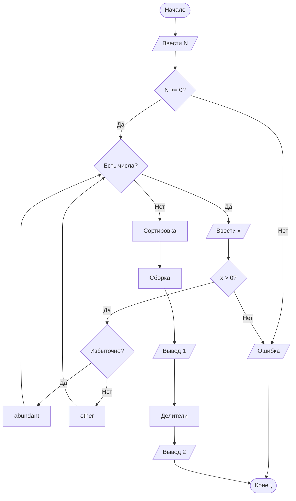

## Отчет по лабораторной работе № 2

#### № группы: `ПМ-2602`

#### Выполнила: `Селиверстова Анжелика Владимировна`

#### Вариант: `19`

### Содержание:

- [Постановка задачи](#1-постановка-задачи)
- [Входные и выходные данные](#2-входные-и-выходные-данные)
- [Выбор структуры данных](#3-выбор-структуры-данных)
- [Алгоритм](#4-алгоритм)
- [Программа](#5-программа)
- [Анализ правильности решения](#6-анализ-правильности-решения)

### 1. Постановка задачи

> Считать число `N` и массив из `N` натуральных чисел. Переставить элементы так, чтобы сначала находились избыточные числа в порядке возрастания, а затем остальные числа в порядке убывания. Вывести количество избыточных чисел. При следующем выводе заменить избыточные числа словом `Избыточных`, а остальные словом `nananan`. После этого заменить каждое число массива количеством его положительных делителей и вывести полученный массив.

Избыточным называется положительное целое число, сумма положительных собственных делителей которого больше самого числа. Собственные делители не включают само число.

Например, собственные делители числа `12`: `1`, `2`, `3`, `4`, `6`. Их сумма равна `16`, а `16 > 12`, поэтому `12` избыточно. У числа `28` сумма собственных делителей равна `28`; оно не является избыточным.

Для массива `[12, 6, 28, 1]` после перестановки получается `[12, 28, 6, 1]`. Количество избыточных чисел равно `1`.

### 2. Входные и выходные данные

#### Данные на вход

Сначала вводится целое число `N`, затем ровно `N` целых чисел. Их можно разделять пробелами или переводами строк. Элементы массива должны быть натуральными, то есть строго положительными. Повторяющиеся значения допустимы.

| Данные | Тип | min значение | max значение |
|---|---|---:|---:|
| Размер массива `N` | `int` | 0 | Ограничен доступной памятью |
| Каждый элемент массива | `int` | 1 | 2 147 483 647 |

Если `N` отрицательно или очередной элемент не является натуральным числом, программа сообщает об ошибке. При `N = 0` обрабатывается пустой массив.

#### Данные на выход

Программа выводит четыре строки:

| Данные | Тип | Возможные значения |
|---|---|---|
| Массив после перестановки | Последовательность `int` | Избыточные числа по возрастанию, остальные по убыванию |
| Количество избыточных элементов | `int` | От `0` до `N` |
| Слова для элементов массива | Строка | `Избыточных` или `nananan` для каждого элемента |
| Массив количеств делителей | Последовательность `int` | Положительное число для каждого элемента |

Количество делителей включает `1` и само число. Так, у `12` шесть положительных делителей: `1`, `2`, `3`, `4`, `6`, `12`.

### 3. Выбор структуры данных

Для чисел используется тип `int`, так как условие требует целые числа, а диапазон этого типа позволяет хранить положительные значения до `2 147 483 647`. Для суммы делителей выбран `long`: сумма нескольких делителей может превышать диапазон `int`.

| Назначение | Переменная | Тип в Java | Размер или диапазон |
|---|---|---|---|
| Размер массива | `n` | `int` | От `0` до размера, допустимого памятью |
| Основной массив | `array` | `int[]` | `n` элементов по 4 байта |
| Избыточные числа | `abundant` | `int[]` | Не более `n` элементов |
| Остальные числа | `other` | `int[]` | Не более `n` элементов |
| Количество чисел в группах | `abundantCount`, `otherCount` | `int` | От `0` до `n` |
| Сумма собственных делителей | `sum` | `long` | Неотрицательное целое число |
| Количество делителей | `count` | `int` | Положительное целое число |
| Текст третьей строки | `words` | `StringBuilder` | Изменяемая строка |

Временные массивы упрощают перестановку: каждую группу можно отсортировать отдельно. Для ввода используется `Scanner`, для сортировки используется `Arrays.sort`. Дополнительная память составляет `O(N)`.

### 4. Алгоритм

#### Алгоритм выполнения программы:

1. **Ввод размера массива.** Прочитать `N`. Если оно отрицательно, сообщить об ошибке.
2. **Ввод и распределение элементов.** Прочитать `N` чисел. Каждое число проверить на положительность. Вычислить сумму его собственных делителей. Если она больше самого числа, поместить число в массив `abundant`, иначе поместить в массив `other`.
3. **Поиск делителей.** Для числа `x` перебирать кандидаты `d` до `√x`. Если `d` делит `x`, учитывать пару `d` и `x / d`. При `d = x / d` одинаковый делитель учитывать один раз. Для суммы собственных делителей число `x` не учитывать.
4. **Сортировка.** Отсортировать заполненные части `abundant` и `other` по возрастанию. Переписать в основной массив сначала `abundant` в прямом порядке, затем `other` в обратном.
5. **Первый вывод.** Вывести отсортированный массив и количество избыточных элементов `abundantCount`.
6. **Вывод слов.** Первым `abundantCount` элементам сопоставить слово `Избыточных`, оставшимся сопоставить `nananan`.
7. **Замена элементов.** Для каждого числа посчитать все его положительные делители, включая `1` и само число. Записать результат на место этого числа и вывести итоговый массив.

Если `M` обозначает наибольший элемент массива, проверка чисел и подсчёт делителей требуют `O(N√M)` времени. Сортировка требует `O(N log N)` времени.

#### Блок-схема



Здесь `abundant` и `other` обозначают массивы для избыточных и остальных чисел. Блок «Вывод 1» печатает упорядоченный массив, количество избыточных элементов и слова. Блок «Вывод 2» печатает массив количеств делителей.

### 5. Программа

Полный текст программы из файла [Main.java](Main.java):

```java
import java.util.Arrays;
import java.util.Scanner;

public class Main {
    public static void main(String[] args) {
        Scanner scanner = new Scanner(System.in);

        int n = scanner.nextInt();
        if (n < 0) {
            throw new IllegalArgumentException("Размер массива не может быть отрицательным");
        }

        int[] array = new int[n];
        int[] abundant = new int[n];
        int[] other = new int[n];
        int abundantCount = 0;
        int otherCount = 0;

        // Разделяем введённые числа на избыточные и остальные.
        for (int i = 0; i < n; i++) {
            int value = scanner.nextInt();
            if (value <= 0) {
                throw new IllegalArgumentException("Элементы массива должны быть натуральными числами");
            }
            array[i] = value;

            if (isAbundant(value)) {
                abundant[abundantCount++] = value;
            } else {
                other[otherCount++] = value;
            }
        }

        // Обе группы сортируем по возрастанию; вторую запишем в обратном порядке.
        Arrays.sort(abundant, 0, abundantCount);
        Arrays.sort(other, 0, otherCount);

        int index = 0;
        for (int i = 0; i < abundantCount; i++) {
            array[index++] = abundant[i];
        }
        for (int i = otherCount - 1; i >= 0; i--) {
            array[index++] = other[i];
        }

        System.out.println("Упорядоченный массив: " + Arrays.toString(array));
        System.out.println("Количество избыточных чисел: " + abundantCount);

        // После перестановки первые abundantCount элементов являются избыточными.
        StringBuilder words = new StringBuilder();
        for (int i = 0; i < n; i++) {
            if (i > 0) {
                words.append(' ');
            }
            words.append(i < abundantCount ? "Избыточных" : "nananan");
        }
        System.out.println("Массив словами: " + words);

        // Заменяем каждый элемент массива количеством его положительных делителей.
        for (int i = 0; i < n; i++) {
            array[i] = countDivisors(array[i]);
        }
        System.out.println("Количество делителей каждого элемента: " + Arrays.toString(array));
    }

    private static boolean isAbundant(int number) {
        if (number == 1) {
            return false;
        }

        // Делители перебираются парами: divisor и number / divisor.
        long sum = 1;
        for (int divisor = 2; divisor <= number / divisor; divisor++) {
            if (number % divisor == 0) {
                sum += divisor;
                int pairedDivisor = number / divisor;
                if (pairedDivisor != divisor) {
                    sum += pairedDivisor;
                }
            }
        }
        return sum > number;
    }

    private static int countDivisors(int number) {
        int count = 0;
        for (int divisor = 1; divisor <= number / divisor; divisor++) {
            if (number % divisor == 0) {
                count += divisor == number / divisor ? 1 : 2;
            }
        }
        return count;
    }
}
```

Для запуска из папки с файлом `Main.java`:

```text
javac Main.java
java Main
```

### 6. Анализ правильности решения

Проверены смешанный массив, отдельные группы чисел, повторения и граничные случаи.

1. Смешанный массив: избыточные, совершенные, простые числа и единица.

    - **Input:**

      ```text
      8
      12 18 6 28 20 1 15 24
      ```

    - **Output:**

      ```text
      Упорядоченный массив: [12, 18, 20, 24, 28, 15, 6, 1]
      Количество избыточных чисел: 4
      Массив словами: Избыточных Избыточных Избыточных Избыточных nananan nananan nananan nananan
      Количество делителей каждого элемента: [6, 6, 6, 8, 6, 4, 4, 1]
      ```

   Избыточные числа `12`, `18`, `20`, `24` находятся в начале по возрастанию. Число `28` попало во вторую группу.

2. Только избыточные числа.

    - **Input:**

      ```text
      4
      24 12 20 18
      ```

    - **Output:**

      ```text
      Упорядоченный массив: [12, 18, 20, 24]
      Количество избыточных чисел: 4
      Массив словами: Избыточных Избыточных Избыточных Избыточных
      Количество делителей каждого элемента: [6, 6, 6, 8]
      ```

   Проверяется сортировка первой группы, когда вторая группа пуста.

3. Нет избыточных чисел.

    - **Input:**

      ```text
      4
      1 2 6 28
      ```

    - **Output:**

      ```text
      Упорядоченный массив: [28, 6, 2, 1]
      Количество избыточных чисел: 0
      Массив словами: nananan nananan nananan nananan
      Количество делителей каждого элемента: [6, 4, 2, 1]
      ```

   Проверяется сортировка второй группы по убыванию и вывод нулевого количества избыточных чисел.

4. Повторяющиеся элементы.

    - **Input:**

      ```text
      5
      12 7 12 1 7
      ```

    - **Output:**

      ```text
      Упорядоченный массив: [12, 12, 7, 7, 1]
      Количество избыточных чисел: 2
      Массив словами: Избыточных Избыточных nananan nananan nananan
      Количество делителей каждого элемента: [6, 6, 2, 2, 1]
      ```

   Оба вхождения `12` считаются отдельными избыточными элементами.

5. Квадрат числа и совершенное число.

    - **Input:**

      ```text
      3
      1 36 28
      ```

    - **Output:**

      ```text
      Упорядоченный массив: [36, 28, 1]
      Количество избыточных чисел: 1
      Массив словами: Избыточных nananan nananan
      Количество делителей каждого элемента: [9, 6, 1]
      ```

   Делитель `6` у числа `36` учитывается один раз. Число `28` не является избыточным.

6. Пустой массив.

    - **Input:**

      ```text
      0
      ```

    - **Output:**

      ```text
      Упорядоченный массив: []
      Количество избыточных чисел: 0
      Массив словами: 
      Количество делителей каждого элемента: []
      ```

   При `N = 0` циклы сортировки, вывода слов и подсчёта делителей не выполняются.

Таким образом, проверены оба порядка сортировки, подсчёт избыточных элементов, повторения, квадрат числа и пустой массив.
